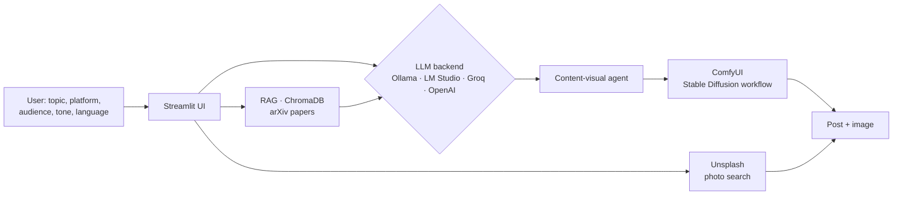

<h1 align="center">🧠 Loki — AI Content Generator (LLMs + Image Generation + RAG)</h1>

<p align="center">
  Generates ready-to-post content for Twitter/X, Instagram, LinkedIn and blogs: the copy is written by an LLM<br/>
  and a matching image is generated with Stable Diffusion, all from a single topic.
</p>

<p align="center">
  
  
  
  
  
  
  
  
  
  
</p>

---

## 🎯 The problem

Small teams need to publish on several platforms, each with its own format, tone and audience, and in more than one language. Loki turns one topic into platform-specific posts with an image, so a content creator only has to review and publish.

## ✨ Features

- **Multi-platform copy**: adapts length, tone and hashtags to Twitter/X, Instagram, LinkedIn, blog…
- **Multiple LLM backends**: local models (Ollama, LM Studio) or APIs (Groq, OpenAI), selectable in the UI
- **Text + image pipeline**: an agent writes the post with an LLM and then generates a matching image locally in **ComfyUI** (Stable Diffusion); the web app can also pick a relevant photo from Unsplash based on concepts extracted from the post
- **RAG module over scientific papers**: arXiv papers ingested into ChromaDB to ground technical posts
- **Multilingual**: prompt templates in 6 languages and automatic translation with DeepL
- **Streamlit** web interface, **Docker** setup and GitHub Actions for PR labelling

## 🏗️ Architecture



## 👤 My role

Team project of 4 at the Factoría F5 AI Bootcamp. I built the **image-generation side**:

- **ComfyUI integration**: client to send Stable Diffusion workflows to ComfyUI's API and retrieve the generated images
- **Content-visual agent** that chains text generation (LM Studio) with image generation (ComfyUI), turning the generated post into an image prompt
- Designed and tuned the **ComfyUI workflows** used for post images
- Fixes to the translation flow in the Streamlit frontend

## 🚀 Run it locally

```bash
git clone https://github.com/mr-melenas/ai-content-generator.git
cd ai-content-generator
python3.11 -m venv venv && source venv/bin/activate   # Windows: venv\Scripts\activate
pip install -r requirements.txt
cp .envexample .env                                    # add Groq / OpenAI / Unsplash / DeepL keys as needed
streamlit run frontend/main.py
```

**Optional local backends**
- **LM Studio** → load a model (e.g. Gemma 3) and start the server at `http://127.0.0.1:1234`
- **ComfyUI** → start it at `http://127.0.0.1:8000` and use the workflow in `data/examples/comfyui_workflow.json`
- **Ollama** → `ollama pull llama3 && ollama serve`

## 🔭 Next steps

- Hosted demo on Streamlit Community Cloud using Groq's free API
- Scheduling and direct publishing to social networks

## 👥 Team

Built at [Factoría F5](https://factoriaf5.org/) by [@mr-melenas](https://github.com/mr-melenas) (Max Beltrán), [@a-bac-0](https://github.com/a-bac-0), Andreina Suescum and Juan Carlos Macías.
Original team repository: [a-bac-0/Loki](https://github.com/a-bac-0/Loki).
